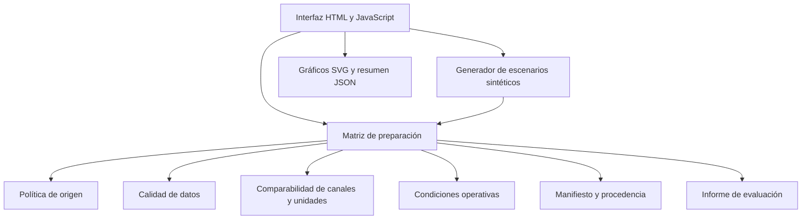

# Arquitectura de la demo

## Objetivo

La publicación es un prototipo pequeño, ejecutable en el navegador y orientado a demostrar reglas de evaluación de evidencia. La arquitectura separa la presentación de los módulos de dominio para que los controles puedan probarse sin depender del DOM.

## Flujo de ejecución

## Responsabilidades

| Módulo | Responsabilidad |
| --- | --- |
| `app/` | Presentación, selección de escenarios, gráficos SVG y descarga del informe. |
| `src/demo-model.mjs` | Construcción determinista de los ejemplos sintéticos y resumen portable. |
| `src/comparison-readiness.mjs` | Orquestación de puertas de evidencia, hallazgos y próximos pasos. |
| `src/source-policy.mjs` | Clasificación de fuentes y bloqueo de mezclas ECU/logger–dinamómetro. |
| `src/data-quality.mjs` | Perfil de muestras, cobertura, secuencia temporal y coherencia de metadatos. |
| `src/run-comparability.mjs` | Detección de canales compartidos y compatibilidad declarada de unidades. |
| `src/operating-conditions.mjs` | Contrato, validación y comparación de condiciones declaradas. |
| `src/run-manifest.mjs` | Identidad, roles, huellas y contexto documentado de los archivos. |

## Límites entre capas

- Los módulos de dominio no acceden al DOM, al almacenamiento del navegador ni a servicios de red.
- El generador produce datos artificiales identificados como sintéticos; no sustituye un parser de archivos.
- La matriz combina los resultados de los módulos, pero no calcula una puntuación de confianza.
- Los gráficos consumen canales que superaron las comprobaciones de origen y unidad. Los datos faltantes interrumpen el trazo; no se interpolan.
- El informe exporta el estado y los máximos observados, no las muestras completas ni rutas locales.
- Los ejemplos de ECU y dinamómetro quedan separados; una relación documental no habilita una comparación numérica cruzada.

## Ejecución y dependencias

La interfaz usa HTML, CSS y módulos ECMAScript nativos. Los gráficos se dibujan en SVG. No hay backend, proceso de build ni dependencias JavaScript de ejecución.

Python puede utilizarse para servir la carpeta localmente, pero no participa del producto. Node.js y Playwright se reservan para las comprobaciones automatizadas.

## Pruebas

- `tests/unit/` valida reglas de dominio, estados, condiciones, procedencia y contratos.
- `tests/browser/` levanta un servidor local efímero y recorre los tres escenarios en Chromium.
- `npm test` ejecuta chequeos de sintaxis, pruebas unitarias y pruebas de navegador.

El detalle de los estados se documenta en [QUALITY_GATES.md](QUALITY_GATES.md). Las pruebas automáticas no demuestran equivalencia física ni validan un vehículo.
